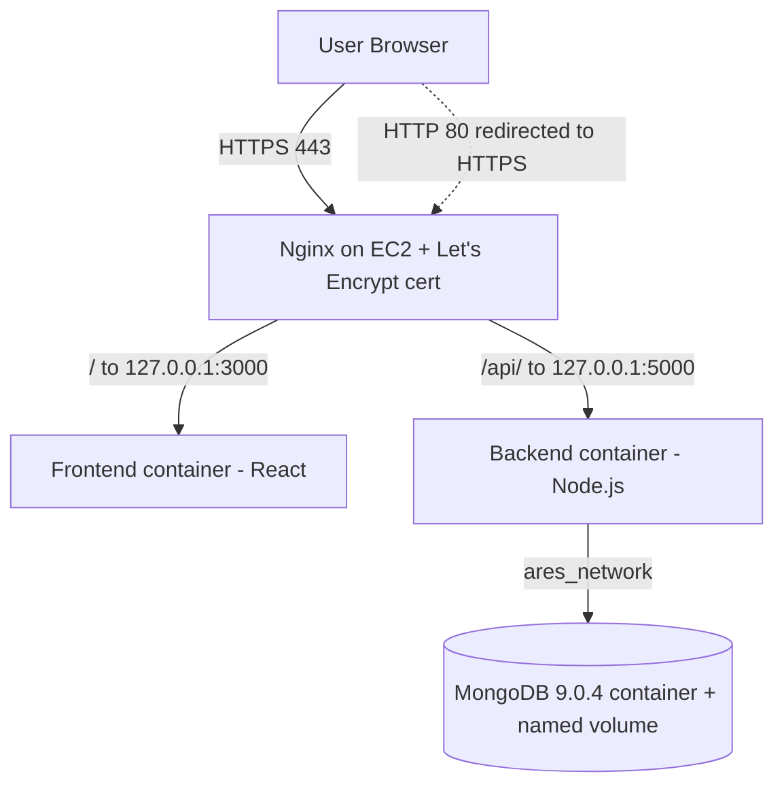
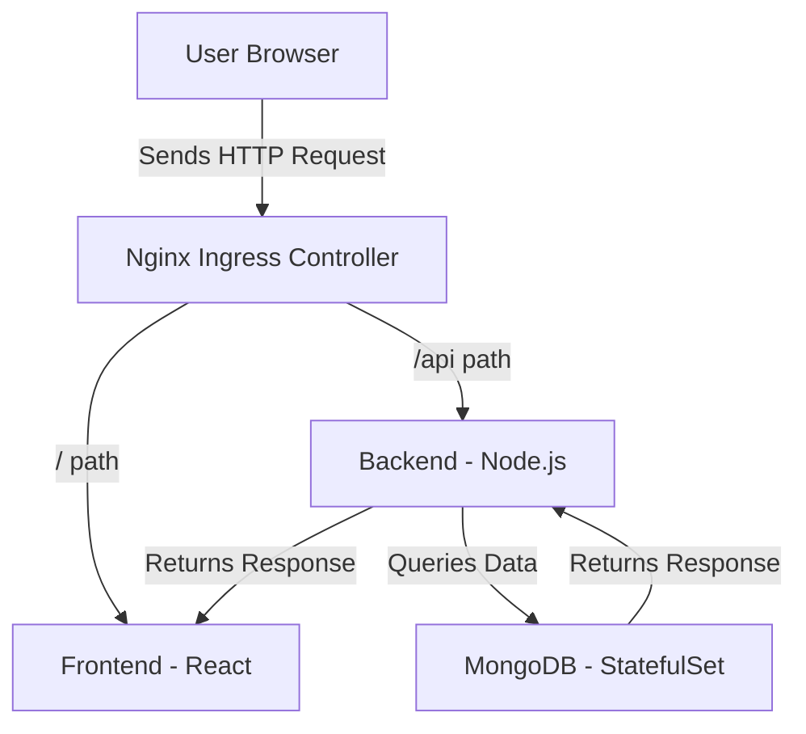
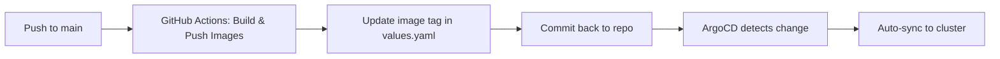

# project-ares
Multi-Service, Three-Tier E-Commerce Web Architecture

## Demo
- **Live (AWS EC2 + Nginx + HTTPS):** https://asad-ares.duckdns.org  ·  API health: https://asad-ares.duckdns.org/api/
- **Video:** [Watch Ares in action](https://youtu.be/Rfx1eItljjs)

## Executive Summary
Project Ares is a three-tier e-commerce architecture engineered to eliminate business loss caused by cascading failures and wasted infrastructure spending.

It runs in two ways:
1. **Production on a single VPS** — AWS EC2 (Ubuntu 26.04 LTS) with Docker Compose, Nginx reverse proxy, a domain and a free Let's Encrypt HTTPS certificate. Only ports 22/80/443 are open; the app containers are not reachable from the internet directly. See [Production Deployment](#-production-deployment-aws-ec2--nginx--https).
2. **Kubernetes (minikube)** — Helm chart, StatefulSet, Ingress and a GitOps CI/CD pipeline (GitHub Actions + ArgoCD).

In the Kubernetes setup, each service (Frontend, Backend, Database) is independently deployable via Helm Charts, independently scalable, and independently recoverable. Persistent data survives pod failures through Kubernetes StatefulSets. External traffic is routed through an nginx Ingress Controller using path-based routing, replacing per-service exposure with a single, centralized entry point.

## Architecture Diagram

### Production (AWS EC2)


### Kubernetes (minikube)


## Tech Stack
**Application**
- React
- Node.js
- MongoDB

**Infrastructure**
- Docker / Docker Compose
- AWS EC2, Elastic IP, Security Groups
- Nginx (reverse proxy) + Certbot (Let's Encrypt HTTPS)
- Kubernetes
- Helm
- Nginx Ingress Controller
- GitHub Actions
- ArgoCD (GitOps)


## Roadmap (Planned)
- [ ] Prometheus + Grafana monitoring
- [ ] Sealed Secrets for credential management
- [ ] AWS EBS-backed persistent storage (production deployment)

## Project Structure

project-ares/
├── frontend/ # React frontend service
├── backend/ # Node.js backend API
├── ares-chart/ # Helm charts for all services
├── deploy/nginx/ares.conf # Nginx reverse proxy config for the VPS
└── docker-compose.yaml # Container setup (local + VPS)


# 🚀 Getting Started

## 📋 Prerequisites

Before running this project, ensure you have the following installed on your system:
- **Docker** (Latest version recommended)
- **Docker Compose**

---

## 🛠️ Installation

Follow these steps to set up the project locally:

1. **Clone the repository:**
```bash
   git clone https://github.com/Asad881/project-ares.git
```

2. **Navigate to the project directory:**
```bash
   cd project-ares
```

---

## ⚡ Running the Project

Start all the services with a single command:

```bash
docker compose up -d --build
```

**This command will automatically:**
- 🏗️ Build the **Frontend** and **Backend** Docker images.
- 💾 Start the **MongoDB** database container.
- 🌐 Create an isolated network (`ares_network`) for secure service communication.
- 🚀 Ensure all services are up, running, and communicating seamlessly.

## Deploying with Helm

Here's how to deploy this project using Helm:

1. **Validate the chart:**
```bash
   helm lint ./ares-chart
```
   This command checks the chart for errors before deploying it.

2. **Install the chart:**
```bash
   helm install ares ./ares-chart
```
   This installs and deploys the chart, giving the release a name (`ares`) so it can be easily identified and managed later.

3. **Verify the deployment:**
```bash
   kubectl get all
```
   This shows the status of all pods, services, and deployments, so you can confirm everything is running correctly or locate where an error occurred.

---

## 🌐 Accessing the Services

Once all containers are successfully running, you can access them via:

| Service | URL / Port |
| :--- | :--- |
| **Frontend (React)** | 💻 [http://localhost:3000](http://localhost:3000) |
| **Backend API** | ⚙️ [http://localhost:5000](http://localhost:5000) |
| **MongoDB** | 🗄️ Internal only (`ares-db:27017` on `ares_network`, not published to the host) |

Ports are published on `127.0.0.1` only, so on a server they are reachable by Nginx but not from the internet.

---

## 🛑 Stopping Services

To stop all running containers and clean up the environment, run:

```bash
docker compose down
```

**What this does:**
- Stops and removes all running project containers.
- Removes the created virtual network.
- 🔒 **Data Safety:** Your database data remains completely safe as the MongoDB volume persists.

---

## 🌍 Production Deployment (AWS EC2 + Nginx + HTTPS)

Live at **https://asad-ares.duckdns.org**.

### Server
| Item | Value |
| :--- | :--- |
| Instance | AWS EC2 `t3.small` (2 GB RAM), 20 GB gp3 disk |
| OS | Ubuntu 26.04 LTS |
| Database image | `mongo:9.0.4` (pinned, persistent named volume `mongo_data`) |
| Public IP | Elastic IP (stays the same across stop/start) |
| Domain | `asad-ares.duckdns.org` (DuckDNS A record → Elastic IP) |
| Security group | 22 (SSH), 80, 443 — ports 3000/5000/27017 are **not** open |
| HTTPS | Let's Encrypt via Certbot, auto-renew timer, HTTP → HTTPS redirect |

### Steps
1. **Launch the server** — EC2 Ubuntu 26.04 LTS, security group with 22 (SSH, best limited to your IP), 80, 443.
2. **Fixed IP + domain** — allocate an Elastic IP, associate it with the instance, point the DuckDNS domain to it. Check: `nslookup asad-ares.duckdns.org`.
3. **Install Docker and run the app**
   ```bash
   git clone https://github.com/Asad881/project-ares.git && cd project-ares
   docker compose up -d --build
   curl localhost:5000      # {"status":"Ares Backend Running","database":"Connected"}
   ```
4. **Nginx reverse proxy**
   ```bash
   sudo apt install -y nginx
   sudo cp deploy/nginx/ares.conf /etc/nginx/sites-available/ares
   sudo ln -s /etc/nginx/sites-available/ares /etc/nginx/sites-enabled/ares
   sudo nginx -t && sudo systemctl reload nginx
   ```
5. **HTTPS**
   ```bash
   sudo apt install -y certbot python3-certbot-nginx
   sudo certbot --nginx -d asad-ares.duckdns.org
   sudo certbot renew --dry-run
   ```

### Verified
- `https://asad-ares.duckdns.org` loads with a valid certificate; `http://` redirects to `https://`
- `https://asad-ares.duckdns.org/api/` → `{"status":"Ares Backend Running","database":"Connected"}`
- `http://<server-ip>:3000` and `:5000` time out from outside
- After a server reboot all 3 containers come back by themselves (`restart: unless-stopped`) and the database data is still there (named volume)
- `certbot renew --dry-run` passes

### Updating the app on the server
```bash
cd project-ares && git pull && docker compose up -d --build
```

---

## Ingress & Traffic Routing (Kubernetes)

### Path-Based Routing Strategy

External traffic entering the cluster is managed via `ares-chart/templates/ingress.yaml` and routed based on the following path rules:

* `/` → frontend-service (Serves the React client application)
* `/api` → backend-service (Serves the Node.js API endpoints)

Both routes use `pathType: Prefix`. This ensures all nested client-side routes (e.g., `/products`, `/cart`) and nested backend API endpoints (e.g., `/api/users/123`) are evaluated correctly using Longest Prefix Matching.

### Architectural Isolation

* **MongoDB Service**: Excluded from the Ingress rules entirely.
* Database traffic remains 100% internal to the cluster.
* The backend communicates with MongoDB via standard Cluster DNS, ensuring zero external exposure.

### Status

**Verified on minikube.** The nginx Ingress Controller was deployed and routing traffic to the frontend and backend services based on the path rules above.

## CI/CD Pipeline



### Overview
Every push to `main` triggers an automated build-and-deploy pipeline, following GitOps principles — Git is the single source of truth for what runs in the cluster.

### Flow
1. **Build & Push**: GitHub Actions builds Docker images for frontend and backend, tagged with the commit's short SHA, and pushes them to Docker Hub.
2. **Tag Update**: The pipeline updates `ares-chart/values.yaml` with the new image tags.
3. **Commit-back**: The updated `values.yaml` is committed back to the repo (with `[skip ci]` to prevent an infinite trigger loop).
4. **Auto-sync**: ArgoCD, running inside the cluster, continuously watches the repo. On detecting the new commit, it automatically syncs the cluster to match — no manual `helm upgrade` needed.

### Tools
- **GitHub Actions** — CI: build, tag, push, commit-back
- **ArgoCD** — CD: git-to-cluster sync, self-healing, drift correction

### Status
**Verified on minikube.** Verified end-to-end with a real code change — commit to cluster deployment, fully automated.